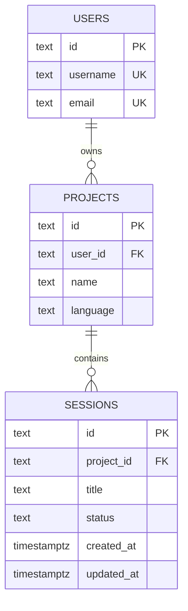

# Osiris — Build 1 alignment

This is a proposed scope for the approved Osiris project, adapted from the teacher's guidance. Initial database SQL and seed data are now available; the CLI, API, and HTTP demonstration remain a work in progress. Start with [database setup](database-setup.md).

## What this increment proves

A user will be able to  retrieve coding-session metadata from a real relational database through the Osiris web service. A basic browser page and the local CLI can use the same API. The AI harness stays local; the service supplies persistent state.

```text
Browser demo ─┐
             ├─ HTTP GET → Axum handler → repository → SQLx → PostgreSQL
Rust CLI ────┘                                                   │
             ◄──────── displayed result ← JSON response ─────────┘
```

Complete both browser reads for the basic service demonstration. CLI read commands are the next small step toward the product. Generating code with a model, executing tools, and fully restoring conversation/tool state are later work.

## Proposed repository layout

```text
Cargo.toml                   Rust workspace and shared dependencies
crates/osiris-cli/           Clap commands and Reqwest API client
crates/osiris-api/           Axum entry point, routes, handlers, repositories
database/initialDB.sql    Initial PostgreSQL schema (available)
database/fakeData.sql           Synthetic demonstration records
public/                     Minimal browser list/detail demonstration
docs/openapi.yaml           Validated contract for implemented routes
requests/build-1.http       Saved HTTP requests
docs/build-1-handoff.md      Actual results, submitted SHA, owners/reviewers
.env.example                Secret-free configuration template
```

Database files are available under `database/`; the rest of this layout is proposed. Configuration should cover the database connection, API bind address, and CLI API base URL.

## Relational model



We will use foreign keys and a status constraint such as (`active`, `completed`, `archived`). Index foreign keys. Users represent synthetic ownership in Build 1; authentication and account-specific access are future work. Run the unauthenticated demonstration locally with synthetic data.

Synthetic sessions under two seeded projects, each belonging to a separate demo account:

| ID | Project ID | Title | Status |
| --- | --- | --- | --- |
| `ses_101` | `prj_ai` | Investigate renderer crash | active |
| `ses_102` | `prj_ai` | Add parser tests | completed |
| `ses_103` | `prj_ai` | Review CLI error messages | archived |
| `ses_201` | `prj_web` | Fix navigation accessibility | active |
| `ses_202` | `prj_web` | Test login form layout | completed |

## Endpoint map

All operations are **planned** until handlers and database reads have been implemented and checked. Keep the existing unprefixed routes from `docs/openai.yaml`.

| Method | URI | Allocation |
| --- | --- | --- |
| GET | `/sessions` | Build 1 |
| GET | `/sessions/{sessionId}` | Build 1 |
| POST | `/projects` | Build 2 |
| GET | `/projects` | Build 2 |
| GET | `/projects/{projectId}` | Build 2 |
| PATCH, DELETE | `/projects/{projectId}` | Build 2 |
| POST | `/sessions` | Build 2 |
| PATCH, DELETE | `/sessions/{sessionId}` | Build 2 |
| GET, POST | `/sessions/{sessionId}/messages` | Build 2 |
| GET, POST | `/sessions/{sessionId}/tasks` | Build 2 |
| POST | `/users` | Build 3 |
| GET, PATCH, DELETE | `/users/me` | Build 3 |
| POST | `/auth/login` | Build 3 |
| POST | `/auth/logout` | Build 3 |

Example **proposed** item response (`200`, `application/json`):

```json
{
  "id": "ses_101",
  "projectId": "prj_elara",
  "title": "Investigate renderer crash",
  "status": "active",
  "createdAt": "2026-10-10T14:00:00Z",
  "updatedAt": "2026-10-14T15:30:00Z"
}
```

The collection response is a plain array of objects with this public shape, matching `docs/openai.yaml`. An empty collection returns `[]` with `200`. An unknown session returns `404`, for example `{"error":{"code":"session_not_found","message":"Session not found."}}`.

The OpenAPI document must declare the required `sessionId` path parameter, session schema, item 200/404 responses, and collection 200 response with populated and empty examples. Validate the actual file in an OpenAPI tool and record the tool and outcome. Keep planned operations clearly labeled or in a separate future-design document.

## Demonstration and evidence

The browser page needs a request-list button, readable list, clickable session IDs or an ID input, and detail/error output. Show the request status and JSON response. Include a readable empty state. Its data must come from HTTP requests, with no embedded seed array.

Record actual results after implementation; these are acceptance criteria, not test results:

| Check | Expected | Actual |
| --- | --- | --- |
| `GET /sessions/ses_101` | 200 JSON object matching its seed row | Not run |
| `GET /sessions/ses_missing` | 404 with clear error and page feedback | Not run |
| `GET /sessions` on seeded fixture | 200 with three sessions for demo account one (two for account two) | Not run |
| `GET /sessions` on empty fixture | 200 with `[]` and page empty state | Not run |

Use a separate test database for the empty fixture. Keep the normal demonstration database intact. Point a separate API instance at the fixture, demonstrate the empty page, then return the demo page to the seeded API and verify all five seed session rows remain. Compare `id` and `title` in SQL output, collection JSON, and item JSON.

For handoff, capture the exact submitted commit with `git rev-parse HEAD` after committing the implementation. Record setup commands, page URL, endpoint statuses, validation output, four expected/actual checks, repository/board/PR links, and real task owners/reviewers. Do not invent team assignments or completed reviews.

## Named follow-up work

| Task | Build | Owner / reviewer |
| --- | --- | --- |
| Session/project writes and multi-step CLI workflow | 2 | Unassigned |
| Message persistence and initial resume workflow | 2 | Unassigned |
| Filtering, sorting, pagination, query validation, navigation links | 2 | Unassigned |
| Local model/tool-loop prototype and provider failure handling | 2 | Unassigned |
| Shared middleware, structured errors, logging, agreed JSON/XML/YAML support | 2 → 3 | Unassigned |
| Provider integration hardening and external-service failure checks | 3 | Unassigned |
| Authentication, ownership authorization, credential handling | 3 | Unassigned |
| Integrity/failure tests and end-to-end CLI resume verification | 3 | Unassigned |

Confirm final build allocation against the teacher-approved exceptions. The full local coding agent is the product roadmap; Build 1 is the first verifiable persistence-service slice.
